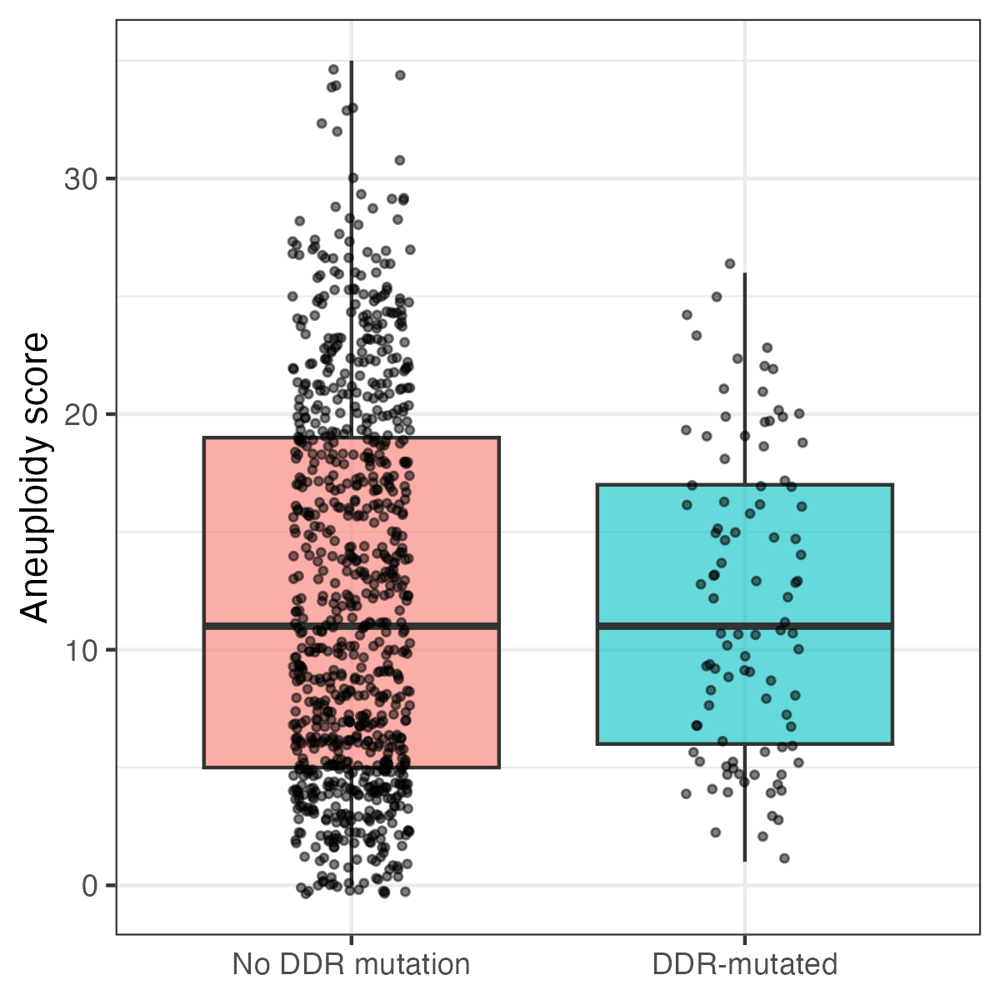
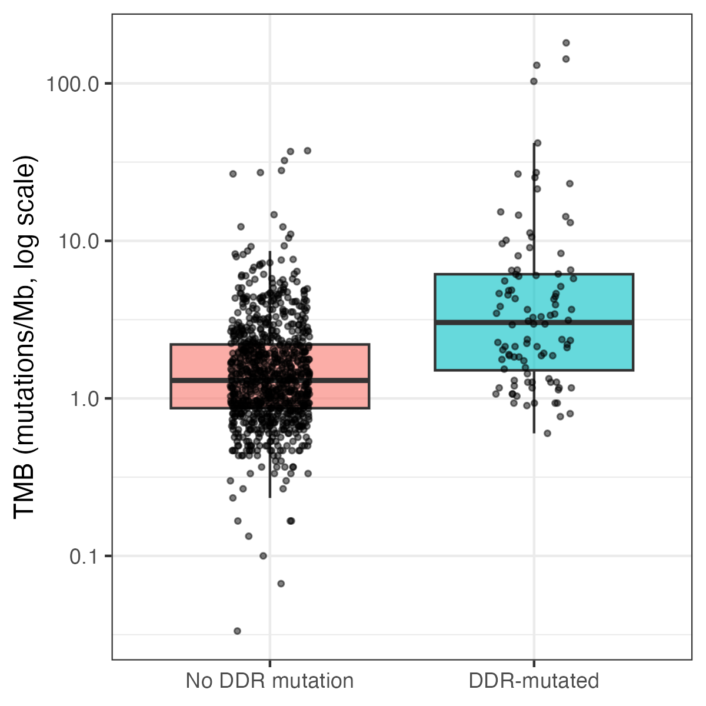
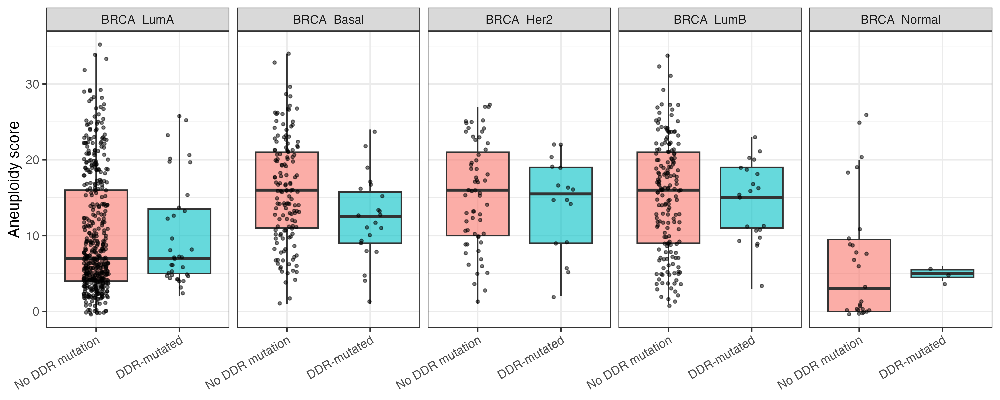

# DNA repair gene mutations and genomic instability in TCGA breast cancer

**Question:** In TCGA breast cancer, do tumours with non-silent mutations in DNA repair genes have a higher aneuploidy score and mutation burden than tumours without them, after accounting for subtype and TP53 status?

## Data
TCGA breast invasive carcinoma, PanCancer Atlas (brca_tcga_pan_can_atlas_2018), downloaded with the cBioPortalData R package. 981 tumours had mutation data and a PAM50 subtype.

## Methods
- **DDR-mutated:** at least one non-silent somatic mutation in BRCA1, BRCA2, PALB2, ATM, CHEK2, RAD51C, RAD51D or BRIP1 (n = 100; 881 without).
- **Outcomes:** aneuploidy score (24 tumours missing, excluded from analysis) and non-synonymous TMB (log10-transformed).
- **Tests:** Wilcoxon rank-sum test, and linear models adjusted for PAM50 subtype (LumA as reference) and TP53 mutation status.
- **Sensitivity analyses:** (1) excluding hypermutated tumours (TMB > 10 mutations/Mb); (2) restricting DDR mutations to loss-of-function variants (nonsense, frameshift, splice site, n = 34).

## Results
| Outcome | Analysis | DDR-mutated coefficient (95% CI)|
|---|---|---|
| Aneuploidy score | Adjusted, all non-silent | −0.8 (−2.4 to 0.7) |
| Aneuploidy score | Adjusted, non-hypermutated | −1.2 (−2.9 to 0.4) |
| Aneuploidy score | Adjusted, LoF only | −1.8 (−4.4 to 0.8) |
| TMB (fold change) | Adjusted, all non-silent | 2.4× (2.0 to 2.8) |
| TMB (fold change) | Adjusted, non-hypermutated | 1.6× (1.4 to 1.8) |
| TMB (fold change) | Adjusted, LoF only | 2.2× (1.7 to 2.9) |
| TMB (fold change) | Adjusted, LoF only, non-hypermutated | 1.6× (1.3 to 2.1) |

- **Aneuploidy:** no evidence of a difference (medians 11 vs 11; Wilcoxon p = 0.94). Intervals exclude increases larger than about 1 point on a 0–35 scale for the main definition, but power is limited for the LoF-only group.
- **Mutation burden:** higher in DDR-mutated tumours. About half of the effect comes from hypermutated tumours (17% of DDR-mutated tumours vs 1.2% of the others).

## Figures

**Aneuploidy score by DDR mutation status**

**Tumour mutation burden by DDR mutation status (log scale)**

**Aneuploidy score by DDR status within each PAM50 subtype** (descriptive only; small groups)

## Limitations
- Somatic mutation calls only. Loss of the second allele (LOH) and germline status were not assessed, so this compares mutation status, not confirmed DNA repair deficiency.
- Mutation burden and DDR mutation status are not independent: tumours with more mutations are more likely to carry a DDR mutation by chance. The association is therefore not evidence that DDR mutations cause higher burden.
- A single-cohort limitation: TCGA only, with no external validation.

## Code development
AI-assisted programming tools were used to support code writing and troubleshooting. The author reviewed and refined the code and is responsible for the analytical workflow and biological interpretation.
